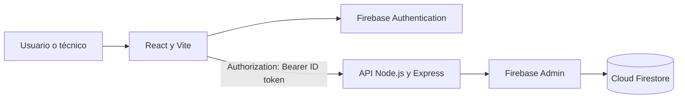
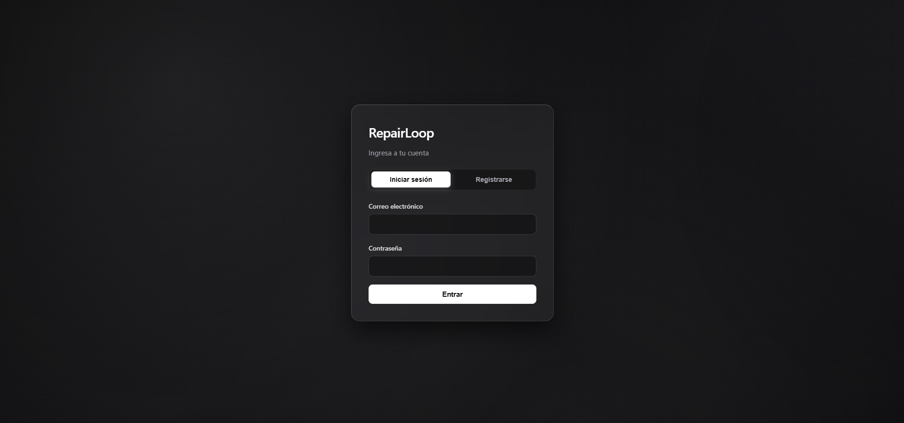
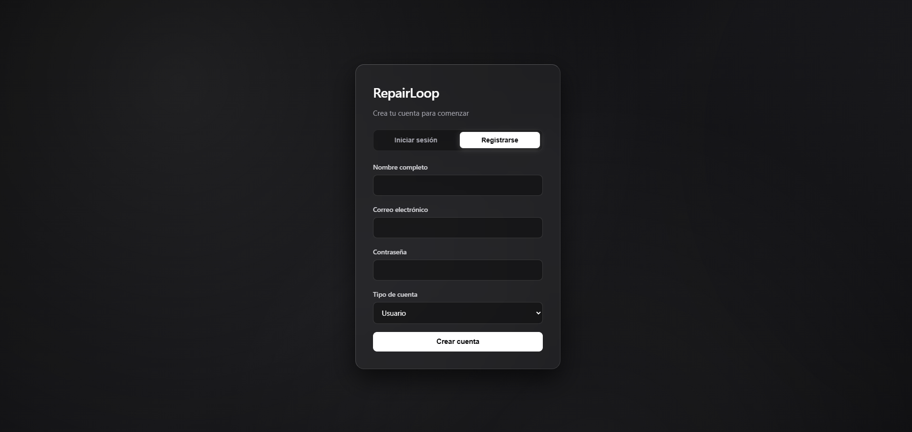
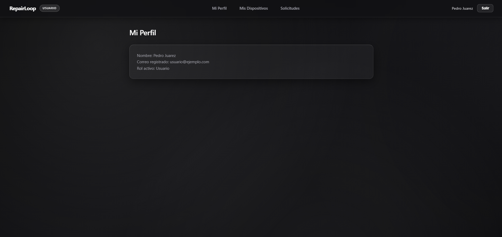
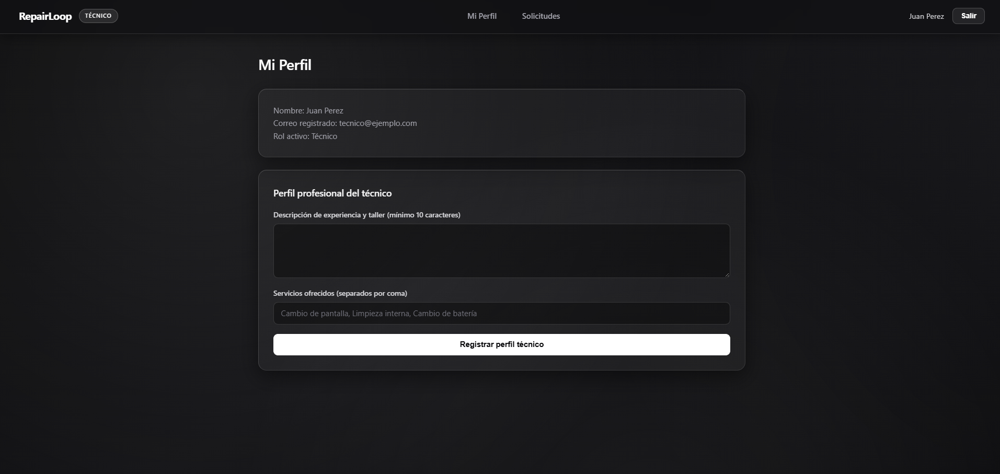
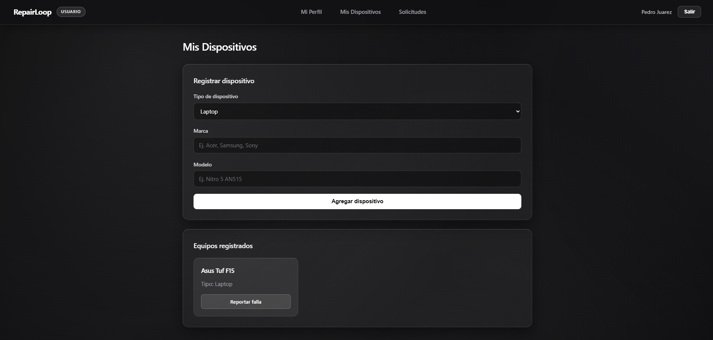
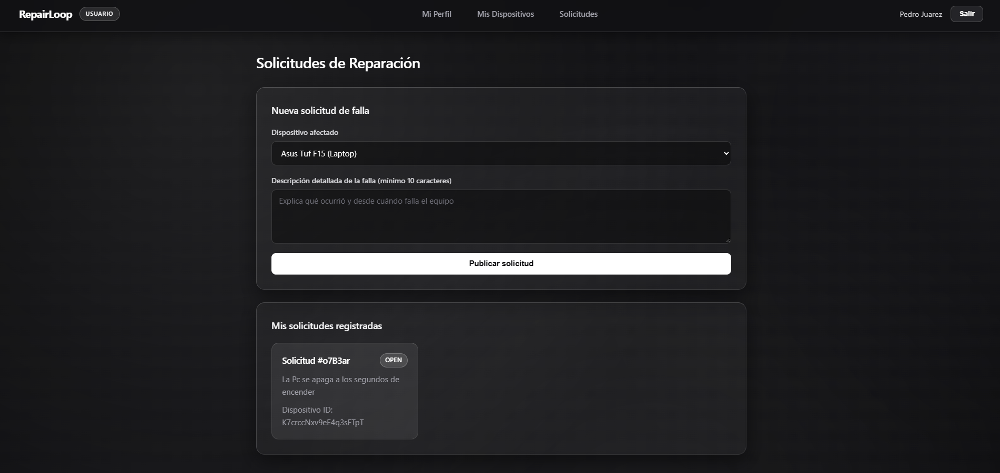
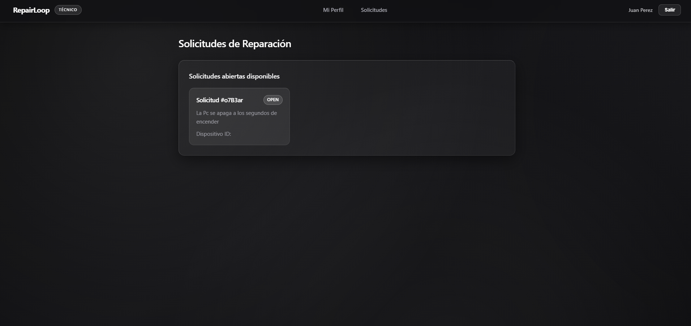

# Arquitectura

## Frontend

El proyecto usa React y Vite en `apps/web`.

- Las vistas son Acceso, Perfil, Dispositivos y Solicitudes.
- Firebase Authentication inicia sesión y proporciona el ID token.
- `mandarPeticion` envía el token a la API.
- Los servicios llaman a `/api/v1/users/me`, `/devices`, `/repair-requests` y `/technicians/me`.

## Backend

La API usa Node.js y Express en `apps/api`.

- `auth.middleware.js` verifica el ID token.
- `role.middleware.js` consulta el rol guardado en `users/<uid>`.
- Los controladores validan los datos recibidos.
- Los servicios leen y escriben Firestore.

## Inicio de sesión

1. El frontend inicia sesión en Firebase.
2. Firebase entrega un ID token.
3. El frontend envía `Authorization: Bearer <ID token>`.
4. Firebase Admin verifica el token.
5. La API consulta el perfil y aplica el rol.

## Permisos

- `usuario`: dispositivos y solicitudes.
- `tecnico`: perfil técnico y solicitudes abiertas.

Las restricciones se aplican en el backend y no dependen únicamente de las rutas visibles del frontend.

## Evidencias

### Inicio de sesión

### Registro

### Perfil de usuario

### Perfil de técnico

### Dispositivos

### Solicitudes del usuario

### Solicitudes del técnico
